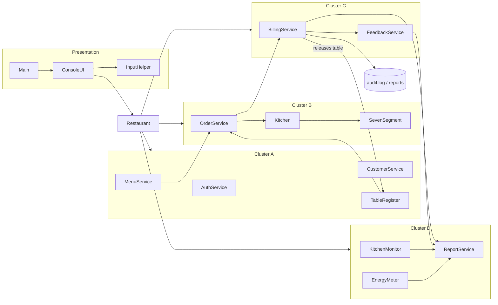
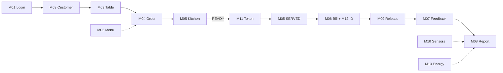

# DineSync: Restaurant Order, Kitchen & Billing System

### Smart Restaurant Management System with IoT-Based Kitchen Monitoring

**Project No:** 15 · **Project Area:** Money & Commerce
**Course:** 26SC1101E – Problem Solving Using Programming (JAVA), PBL, Sem I · Department of FED · A.Y. 2026–27 (I-I Semester)

## Team Members

| Student Name | Roll Number | Branch |
|---|---|---|
| Pranathi Kusi | 2620040061 | ECE – Section 15 |
| M. Sri Akhil Chowdary | 2620040112 | ECE – Section 15 |

**Supervisor:** Dr. K. Sreeram Murthy

---

## Abstract

Every restaurant runs on three constant tasks: taking orders, preparing food, and generating bills. When these are handled on paper, orders get lost, the kitchen hears about them late, and bills come out wrong.

**DineSync** is a Core Java console application that connects the waiter, kitchen, cashier and manager into one order flow. Staff log in by role. Customers are identified by mobile number and their favourite dishes are shown first. Tables are allocated from an 8-bit occupancy register, and orders go straight to a priority kitchen queue. Bills are calculated with a loyalty discount, CGST and SGST, and every bill ID carries a check digit that catches typing mistakes. Simulated kitchen sensors raise safety alerts, a seven-segment display shows ready tokens, an energy meter works out the kitchen's electricity cost, and the admin gets daily reports built from real transactions.

**Keywords:** Restaurant Management, Order Processing, Kitchen Queue, Billing, GST, Check Digit, Bitwise Register, Core Java, Arrays, OOP, Exception Handling, Collections, Streams

---

## Quick start

You need **JDK 17 or later** (the course handout recommends JDK 21). No libraries, no database, no internet connection.

### Windows: Command Prompt (works with files written in Notepad)

```cmd
cd path\to\this\repository\src
javac *.java
java Main
```

Run with the document's demo situation already loaded (Priya Sharma, busy tables, appliances):

```cmd
java Main --demo
```

Run the automated tests:

```cmd
java DineSyncTests
```

Run any single module on its own. Every module class has its own `main()` method:

```cmd
java TableRegister
java BillingService
java KitchenMonitor
```

### VS Code

1. Install the **Extension Pack for Java**.
2. **File → Open Folder…** and choose this repository's folder (the one that contains `src`).
3. Open `src/Main.java` and click **Run** above `main`. Any other file with a `main` method (for example `src/EnergyMeter.java` or `src/DineSyncTests.java`) can be run the same way.

`.vscode/settings.json` already tells VS Code that the source folder is `src`.

### Linux / macOS

```bash
cd src && javac *.java && java Main --demo
```

### Command-line options

| Option | Effect |
|---|---|
| `--demo` | Loads the labelled demo fixtures from the project document (see "Demo fixtures" below) |
| `--fast` | Sensor scans do not wait between scans (handy during a live demo) |
| `--ascii` / `--unicode` | Use `Rs.` and plain symbols, or the ₹ ✔ ✘ symbols |
| `--color` / `--no-color` | Turn colours on or off |

Colours and symbols are chosen automatically: the old Windows `cmd` window gets plain ASCII with no colour codes, while VS Code and Windows Terminal get colours.

### Demo staff accounts (demo PINs only, not real credentials)

| Role | Staff ID | Name | PIN |
|---|---|---|---|
| Waiter | W104 | Kiran | 4821 |
| Waiter | W105 | Ravi | 1357 |
| Chef | C201 | Meena | 2468 |
| Chef | C202 | Arjun | 8642 |
| Cashier | K301 | Lakshmi | 3690 |
| Admin | A401 | Suresh | 9999 |

---

## What the program does: 13 modules in 4 clusters

| Cluster | Module | What it does | Main classes |
|---|---|---|---|
| **A. Identity, Menu, Customers & Tables** | M01 Login & Access Control | Role-based login, Staff ID format check, 4-digit PIN, account lock after 3 wrong PINs, admin unlock | `Staff`, `AuthService` |
| | M02 Menu Management | Add, re-price and enable/disable dishes; 30-dish array; duplicate and range checks | `MenuItem` (abstract), `VegItem`, `NonVegItem`, `Beverage`, `MenuService` |
| | M03 Customer Profile & Favourites | Mobile number lookup, new profiles, visit count, 10% loyalty on every 7th visit, top-3 favourites, veg-only filter | `Customer`, `CustomerService` |
| | M09 Table Occupancy Register | 8 tables in one 8-bit register; binary, hex and decimal display; smallest-fitting-table suggestion | `TableRegister` |
| **B. Ordering, Kitchen & Token** | M04 Order Taking | Dine-in or takeaway, quantity 1–10, 20-item limit, merges repeated dishes, diet and availability checks, spice level, note | `Order`, `OrderItem`, `OrderService` |
| | M05 Kitchen Queue | Urgent first, then oldest; ETA; chef assignment; strict PLACED → PREPARING → READY → SERVED | `Kitchen` |
| | M11 Seven-Segment Token | Token validation, 3-digit padding, ASCII digits and 7-bit segment codes | `SevenSegment` |
| **C. Billing, Checksum & Feedback** | M06 Billing & Payment | Only after SERVED; loyalty discount; CGST + SGST 2.5% each; cash, UPI or card; split 1–8; releases the table | `Bill`, `Billable` (interface), `BillingService` |
| | M12 Bill Checksum Security | Bill ID `NNNN-D`; weighted digit sum (recursive); format, checksum and existence checks | `BillingService` |
| | M07 Feedback & Ratings | Verified bill, one feedback per bill, overall and per-dish ratings, running averages | `Feedback`, `FeedbackService` |
| **D. Monitoring, Energy & Analytics** | M10 Kitchen Sensor Monitoring | 4 simulated sensors in one `Sensor[]`, admin thresholds, alert log, automatic actions, safe interruption | `Sensor` (interface), `AbstractSensor`, 4 sensor classes, `KitchenMonitor` |
| | M13 Kitchen Energy Meter | kW = V × I × PF ÷ 1000; kWh; 20 units at ₹6 then ₹8; highest consumer | `Appliance`, `EnergyMeter` |
| | M08 Reports & Analytics | Summary, top dishes, hourly (2-D array), staff; date validation; text-file export | `ReportService`, `DateHelper` |

Supporting classes: `Main`, `ConsoleUI`, `InputHelper`, `Colors`, `Restaurant` (wires everything together), `FileStore` (file I/O), `DateHelper`, `DemoData`, `ConceptShowcase` (Java concepts lab), `DineSyncTests`, and 38 exception classes (`DineSyncException`, the checked parent; 36 checked module exceptions such as `InvalidPinException`; and `InvalidMenuChoiceException`, which is unchecked).

### Architecture



### One customer visit, end to end



---

## Verified results (from real program runs)

| Check | Expected (project document) | DineSync output |
|---|---|---|
| Priya Sharma, visit #14 | Loyalty ON (14 % 7 = 0) | ✔ |
| Table register for a party of 5 | Suggest T6; 0x4A → 0x4E → 0x4A | ✔ |
| Order #2001 | 6 items, ₹920.00 | ✔ |
| Kitchen ETA with 2 orders ahead | 20 + 2 × 2 = 24 min | ✔ |
| Bill | ₹920 − ₹92 = ₹828; CGST ₹20.70; SGST ₹20.70; total ₹869.40 | ✔ |
| Cash ₹900, split 2 | Change ₹30.60; ₹434.70 each | ✔ |
| Bill ID | 1×1 + 0×2 + 0×3 + 2×4 = 9 → `2001-9` | ✔ |
| Swapped ID `2010-9` | Rejected, check digit should be 0 | ✔ |
| Feedback | 4.5★ from 215 reviews | ✔ (with the demo baseline of 214 earlier reviews) |
| Energy | 26.70 kWh; 20 × 6 + 6.70 × 8 = ₹173.60 | ✔ |
| Token 107 | 0x30, 0x7E, 0x70 | ✔ |

**Automated tests: 186 passed, 0 failed.** See [`docs/TEST_RESULTS.md`](docs/TEST_RESULTS.md) for the full output and [`demo/demo-transcript.txt`](demo/demo-transcript.txt) for a complete recorded run of the program.

---

## Documentation

| File | Contents |
|---|---|
| [`docs/CURRICULUM_MATRIX.md`](docs/CURRICULUM_MATRIX.md) | Every PSP syllabus topic (Modules 1–6, CO1–CO6), where it is used (class and method) and how it is verified |
| [`docs/MODULE_AUDIT.md`](docs/MODULE_AUDIT.md) | All 13 modules checked rule by rule, plus the final verification checklist |
| [`docs/DESIGN_DECISIONS.md`](docs/DESIGN_DECISIONS.md) | Places where the documents disagree or are silent, and what was decided |
| [`docs/ALGORITHMS.md`](docs/ALGORITHMS.md) | Algorithms, pseudocode and flowcharts for the main operations |
| [`docs/TEST_RESULTS.md`](docs/TEST_RESULTS.md) | Test plan and the actual test output |
| [`docs/VIVA_GUIDE.md`](docs/VIVA_GUIDE.md) | Beginner-friendly walkthrough of the code, common mistakes, and viva questions and answers |
| [`docs/DEMO_SCRIPT.md`](docs/DEMO_SCRIPT.md) | Step-by-step live demonstration for the expo |
| [`docs/POSTER_CONTENT.md`](docs/POSTER_CONTENT.md) | Ready-to-use poster text |
| [`docs/PRESENTATION_CONTENT.md`](docs/PRESENTATION_CONTENT.md) | 18-slide presentation content with speaker notes |

---

## Repository layout

```
├── src/                 all Java source files (no packages: javac *.java just works)
├── data/menu.csv        starting menu, read at start-up (the built-in menu is used if it is missing)
├── demo/                demo-input.txt (scripted run) and demo-transcript.txt (its real output)
├── docs/                documentation listed above
├── scripts/             run.bat / run.sh / test.bat / test.sh helpers
├── .vscode/             VS Code settings (source folder = src)
└── README.md
```

---

## Known limitations (honest status)

- **Data is in memory only.** Customers, orders, bills and feedback live in arrays and are cleared when the program closes. Files are used only for the starting menu (`data/menu.csv`), the audit log, and exported reports. Changes made to the menu while the program runs are not written back to the CSV.
- **Sensors are simulated** with `Math.random()`. No hardware is connected. The "Simulate overheat" option exists so the alert can be shown on demand.
- **Payments are simulated.** No payment gateway is involved, UPI only checks that the reference has 12 digits, and card payments collect no card data.
- **One user at a time** at a single console. There is no network or multi-terminal support.
- **Reports cover only the current run**, because nothing is stored between runs. Energy cost is shown only for today's date.
- Ready tokens are numbered from 101 in the order dishes become READY. The project document's "token 107" is shown with the standalone token tool. See `docs/DESIGN_DECISIONS.md`.

## Future roadmap (proposals, not implemented)

1. **Phase 1, done:** Academic Core Java prototype (this repository): 13 modules, arrays, console, simulated monitoring.
2. **Phase 2:** Durable storage. Save customers, bills and feedback to files and later a database.
3. **Phase 3:** Graphical or web interface using technologies from later courses.
4. **Phase 4:** Connected operations. Several terminals (waiter tablets, kitchen screen) sharing live order updates.
5. **Phase 5:** Online ordering and delivery. QR table ordering, a real payment gateway, delivery tracking.
6. **Phase 6:** Production platform. Security, monitoring, scaling, and real sensors through a microcontroller.

## Demo fixtures

`java Main --demo` loads clearly labelled starting data that recreates the project document's scenario: tables T2, T5 and T7 already busy (register `0x4A`), returning customer Priya Sharma (13 earlier visits, veg only, favourite dish counts), a rating history of 214 earlier reviews, and three metered appliances. **None of this is treated as a real transaction.** Revenue and bills only ever come from orders actually placed and paid during the run.
