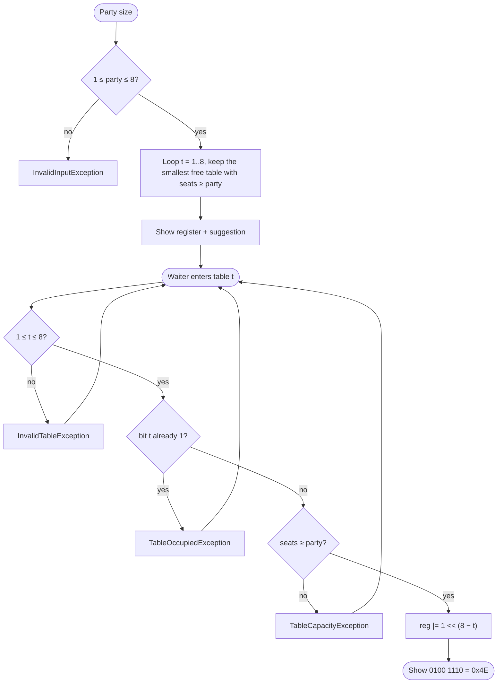
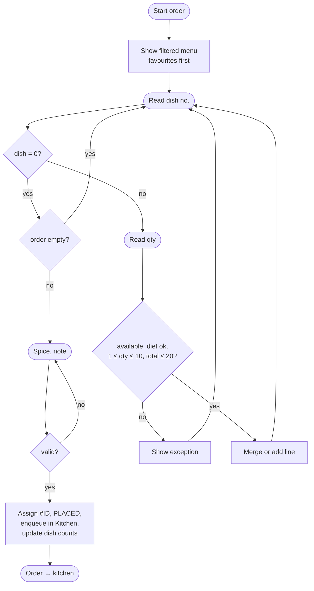
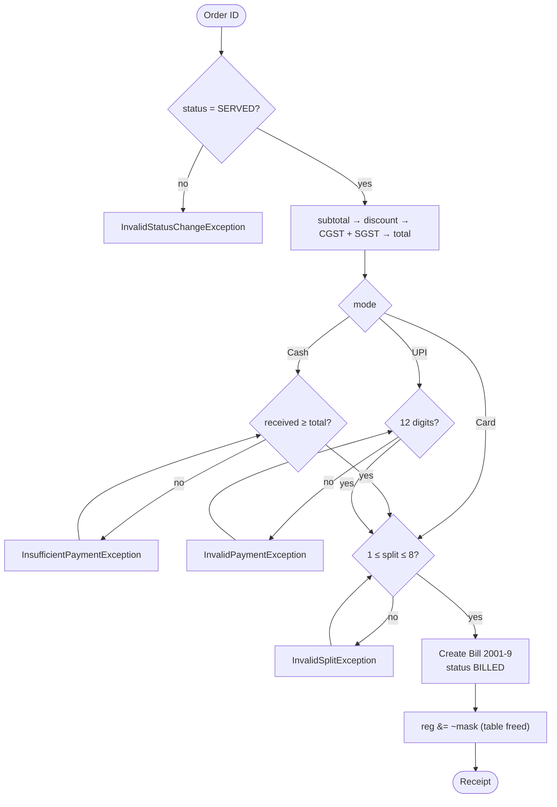

# Algorithms, Pseudocode, Flowcharts and Trace Tables (CO1)

Flowcharts use Mermaid, which GitHub draws as diagrams automatically.

## 1. IPO (Input → Process → Output) for every module

| Module | Input | Process | Output |
|---|---|---|---|
| M01 Login | role, Staff ID, PIN | check format → linear search `Staff[]` → compare PIN → count failures | welcome + role menu, or lock message |
| M02 Menu | name, category, type, price, prep, available | capacity → name → duplicate → ranges → create subclass object | "Added #14 …" |
| M03 Customer | mobile (+ name, diet if new) | validate → linear search → visit++ → `visits % 7 == 0` → top 3 | welcome, visit #, loyalty, favourites |
| M09 Tables | party size, table no. | bit test → smallest free fit → `reg \|= mask` | register in binary/hex/decimal |
| M04 Order | type, dish no., qty, spice, note | diet + availability → merge → limits → subtotal → ID → queue | "Order #2001 → kitchen · 6 items · ₹920" |
| M05 Kitchen | order ID, action | sort (urgent, oldest) → ETA → next stage only | queue view; READY → token + buzzer |
| M11 Token | token text, style | digits only → pad to 3 → look up codes | ASCII digits + 7-bit codes |
| M06 Billing | order ID, mode, cash/UPI ref, split | SERVED? → discount → GST → payment checks → bill → release table | receipt, change, per-person share |
| M12 Checksum | bill ID `NNNN-D` | split at `-` → weighted sum (recursive) → `% 10` → binary search | genuine / exact reason rejected |
| M07 Feedback | bill ID, ratings, comment | verify → not duplicate → 1–5 checks → running average | thank-you + average |
| M10 Sensors | limits, scans, interval | read → compare → catch alert → log → sleep | OK/ALERT lines, alert count |
| M13 Energy | name, V, I, PF, hours | kW, kWh, total, slab cost, max | appliance table, total, cost |
| M08 Reports | date, type, top N | validate date → filter bills by date → sum, count, sort | summary / top / hourly / staff |

---

## 2. Table allocation (M09)

**Pseudocode**
```
SUGGEST(party):
    best ← 0
    FOR t ← 1 TO 8
        IF table t is busy OR seats[t] < party THEN CONTINUE
        IF best = 0 OR seats[t] < seats[best] THEN best ← t
    RETURN best                      // 0 means no table fits

ALLOCATE(t, party):
    IF party < 1 OR party > 8  THROW InvalidInputException
    IF t < 1 OR t > 8          THROW InvalidTableException
    IF (reg AND mask(t)) ≠ 0   THROW TableOccupiedException
    IF seats[t] < party        THROW TableCapacityException
    reg ← reg OR mask(t)       // mask(t) = 1 << (8 − t)
```



## 3. Order placement (M04)

```
START_ORDER(waiter, customer, type, table)
    require role = Waiter; customer identified
    IF dine-in: table must be allocated and have no unpaid order
ADD_ITEM(order, dishNo, qty)
    dish ← menu[dishNo]                  // ItemUnavailableException if missing
    IF not available                     THROW ItemUnavailableException
    IF customer is veg-only AND dish is non-veg  THROW ItemUnavailableException
    IF qty < 1 OR qty > 10               THROW InvalidQuantityException
    IF totalQty + qty > 20               THROW OrderLimitExceededException
    IF dish already in order THEN line.qty ← line.qty + qty   (still ≤ 10)
    ELSE add new OrderItem
PLACE(order, spice, note)
    check: not empty, spice 1–3, note ≤ 60
    order.id ← nextId; status ← PLACED; stamp date/hour
    kitchen.enqueue(order); store in Order[]; customer.dishCount[dish] += qty
```



## 4. Billing (M06 + M12 + M09)

```
BILL(orderId, mode, …)
    order ← find(orderId); IF status ≠ SERVED  THROW InvalidStatusChangeException
    subtotal ← Σ unitPrice × qty
    discount ← loyalty ? round2(subtotal × 0.10) : 0
    taxable  ← subtotal − discount
    cgst ← round2(taxable × 0.025); sgst ← round2(taxable × 0.025)
    total ← round2(taxable + cgst + sgst)
    CASH: IF received < total THROW InsufficientPaymentException(total − received due)
    UPI : IF ref is not 12 digits THROW InvalidPaymentException
    IF split < 1 OR split > 8 THROW InvalidSplitException
    billId ← orderId + "-" + checkDigit(orderId)
    store Bill; order.status ← BILLED; release table; append audit log
```



### Worked example (from the document, reproduced by the program)

| Step | Calculation | Value |
|---|---|---|
| Item total | 120 + 220 + 2×250 + 2×40 | 920.00 |
| Loyalty (visit 14, 14 % 7 = 0) | 920 × 10 % | −92.00 |
| Taxable | 920 − 92 | 828.00 |
| CGST / SGST | 828 × 2.5 % | 20.70 each |
| Grand total | 828 + 20.70 + 20.70 | 869.40 |
| Change | 900 − 869.40 | 30.60 |
| Split 2 | 869.40 ÷ 2 | 434.70 |

## 5. Check digit, recursive (M12)

```
weightedSum(n, w):
    IF n = 0 RETURN 0                                // base case
    RETURN (n MOD 10) × w + weightedSum(n DIV 10, w + 1)   // recursive case
checkDigit(n) = weightedSum(n, 1) MOD 10
```

**Trace table** for `weightedSum(2001, 1)` (desk check):

| Call | n | w | n % 10 | n / 10 | returns |
|---|---|---|---|---|---|
| 1 | 2001 | 1 | 1 | 200 | 1×1 + call 2 = 1 + 8 = **9** |
| 2 | 200 | 2 | 0 | 20 | 0×2 + call 3 = 8 |
| 3 | 20 | 3 | 0 | 2 | 0×3 + call 4 = 8 |
| 4 | 2 | 4 | 2 | 0 | 2×4 + call 5 = 8 |
| 5 | 0 | 5 | – | – | **0** (base case, recursion stops) |

9 % 10 = 9 → bill ID **2001-9**. For 2010: 0×1 + 1×2 + 0×3 + 2×4 = 10 → 0, so `2010-9` is rejected.

## 6. Kitchen priority and ETA (M05)

```
compareTo(a, b): IF a.urgent ≠ b.urgent THEN urgent one first ELSE smaller sequence (older) first
ETA(order) = longest prep time in order + 2 × (orders ahead still PLACED or PREPARING)
```
Example: #2002 (urgent), #2003 (urgent), #2001 (normal, Veg Biryani 20 min) → ETA = 20 + 2 × 2 = **24 min**.

## 7. Top-N dishes, selection sort (M08)

```
copy dishes with count > 0 into items[], values[]
FOR i ← 0 TO size − 2
    maxPos ← i
    FOR j ← i + 1 TO size − 1
        IF values[j] > values[maxPos] THEN maxPos ← j
    swap values[i] ↔ values[maxPos]; swap items[i] ↔ items[maxPos]
RETURN first N items
```

**Trace** for counts `{dish2: 9, dish4: 5, dish1: 2}` (array `[0, 2, 9, 0, 5]`):

| Pass i | Array of values before | max found | After swap |
|---|---|---|---|
| 0 | [2, 9, 5] | 9 at pos 1 | [9, 2, 5] |
| 1 | [9, 2, 5] | 5 at pos 2 | [9, 5, 2] |
Result for N = 2: dishes **2, 4** (this case is checked by an automated test).

## 8. Date validation (M08)

```
parts ← text.split("-"); require 3 parts of lengths 2, 2, 4
day, month, year ← parseInt (letters → NumberFormatException → InvalidDateException)
month in 1..12; day in 1..daysIn(month, year)   // February: 29 if leap year
leap(y) = (y % 4 = 0 AND y % 100 ≠ 0) OR y % 400 = 0
yyyymmdd(date) ≤ yyyymmdd(today) else "future date"
```

## 9. Energy slab tariff (M13)

```
P(kW)  = V × I × PF ÷ 1000
E(kWh) = P × hours
units  = round2(Σ E)
cost   = min(units, 20) × 6 + max(units − 20, 0) × 8
```
26.70 units → 20 × 6 + 6.70 × 8 = 120.00 + 53.60 = **₹173.60**.
